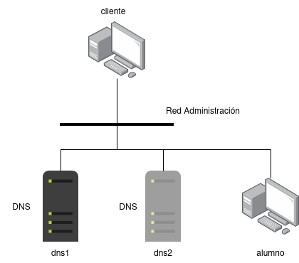

# Práctica 0104
Despliegue de Aplicaciones Web

`Curso 2026/2027`

## 1. Despliegue de un directorio ligero LDAP

El objetivo de esta práctica es realizar la instalación y configuración de un servidor de directorio ligero LDAP. Para ello necesitaremos dos máquinas virtuales con sistema operativo [Ubuntu Server](https://www.ubuntu.com/server). La primera máquina (ldap) actuará como servidor y sobre ella deberá llevarse a cabo la instalación y configuración del servicio OpenLDAP (slapd) bajo el dominio que el profesor indique, o el elegido por el alumno. La segunda máquina (xampp) acutará como cliente y deberá configurarse para realizar la autenticación de usuarios contra el servidor LDAP.

### 1.1. Arquitectura web con un único servidor
En esta práctica vamos a trabajar con una arquitectura basada en el modelo cliente/servidor.

HACER IMAGEN


**Ventajas**

* Auntenticación centralizada mediante una única cuenta para todos los equipos y servicios.
* Gestión centralizada (altas, bajas y modificaciones) de recursos de la red.
* Protocolo estándar y abierto, compatible con multitud de sistemas y aplicaciones.
* Ligero y de bajo consumo de recursos.

**Inconvenientes**

* El servidor LDAP constituye un **punto único de fallo** si no se replica.
* Requiere del cifrado de la comunicación (LDAPS/StartTLS) para evitar que las credenciales viajen en claro por la red.
* Configuración manual laboriosa y propensa a errores (esquemas, DN, ACLs, etc.)

### 1.2. Tareas a realizar

A continuación se describen las tareas a realizar.

1. Instalar y configurar adecuadamente el servicio OpenLDAP en el servidor, con un dominio base.
2. Crear la estructura de directorio mediante ficheros **LDIF** donde se incluyan, al menos: dos unidades organizativas (ou), tres usuarios (incluyendo el/los alumnos) con la clase `posixAccount` (uid, uidNumber, gidNumber, homeDirectory y loginShell) y contraseñas almacenadas con hash


3. Instalar y configurar el cliente de directorio ligero en la máquina `xampp`
4. Comprobar el acceso de un usuario de alta en el directorio dentro de la máquina `xampp`
5. Instalar el stack web XAMPP en la máquina `xampp`

> IMPORTANTE
> En Ubuntu, la cuenta de `root` no está activada, pero habrá que ser `root` para poder hacer cambios en la configuración de los servicios.

### 1.3. Entregables

Deberá crear un repositorio en [Github](https://github.com/) con el nombre de la práctica y añadir al profesor como colaborador.

El repositorio debe tener el siguiente contenido:
* Un **documento técnico** con la descripción de todos los pasos que se han llevado a cabo.
* Los **scripts de Bash** que se han utilizado para automatizar la instalación y configuración de Webmin, así como de las herramientas adicionales.

Además del contenido anterior puede ser necesario crear otros archivos de configuración, que deberán ser documentados e incluidos dentro del entregable. A continuación se muestra un ejemplo de cómo puede ser la estructura del repositorio:

```
.
├── README.md
├── images
└── scripts
    ├── .env
    └── webmin-install.sh
```

#### 1.3.1. Documento técnico
El documento técnico `README.md` tiene que estar escrito en Markdown y debe incluir como mínimo los siguientes contenidos:

* Descripción de la instalación y configuración del servicio de directorio ligero LDAP
* ~~Cada descripción debe ir acompañada de **alguna/s captura/s de pantalla**, donde se pueda ver claramente los pasos que se han llevado a cabo~~

#### 1.3.2. Scripts en Bash
El directorio `scripts` debe incluir los siguientes archivos:

* `.env`: Este archivo contendrá todas las variables de configuración que se utilizarán en los scripts de Bash.
* `webmin-install.sh`: Este archivo contendrá todas las instrucciones para automatizar el proceso de instalación de Webmin.
* 

## 1.4. Anexo. ¿Cómo gestionar los archivos .env?
Los archivos `.env` son archivos de texto que se suelen utilizar para almacenar variables de entorno con información sensible, com contraseñas, claves de API, etc.

Estos archivos no se deberían subir a un repositorio público, porque cualquier persona podría acceder a ellos y obtener las contraseñas que contienen.
